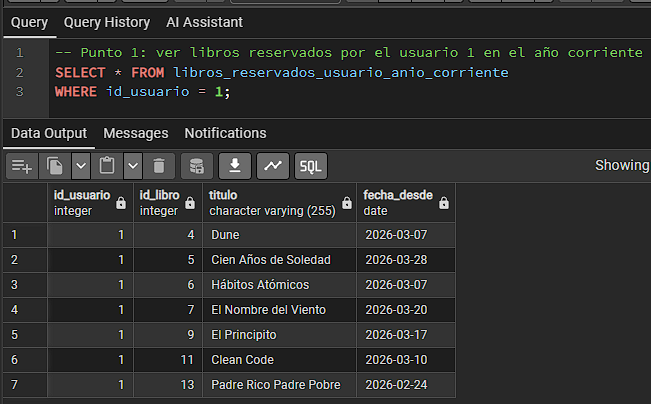
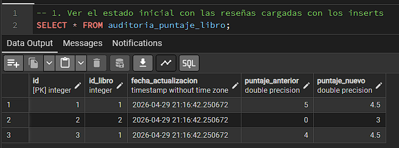
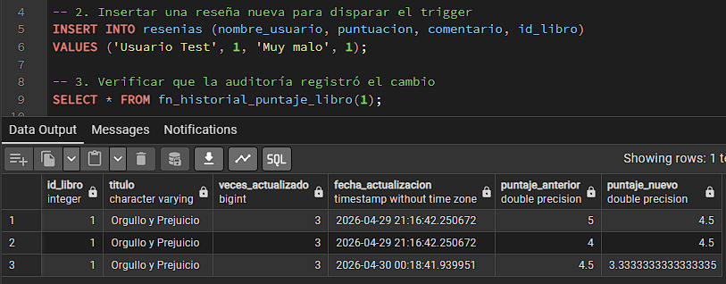
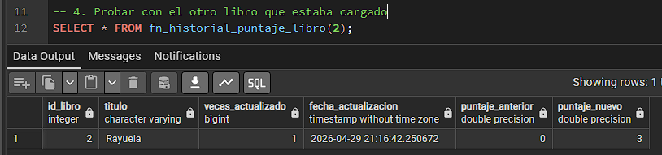
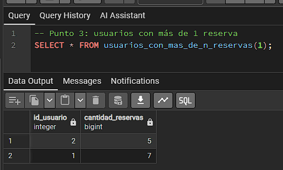
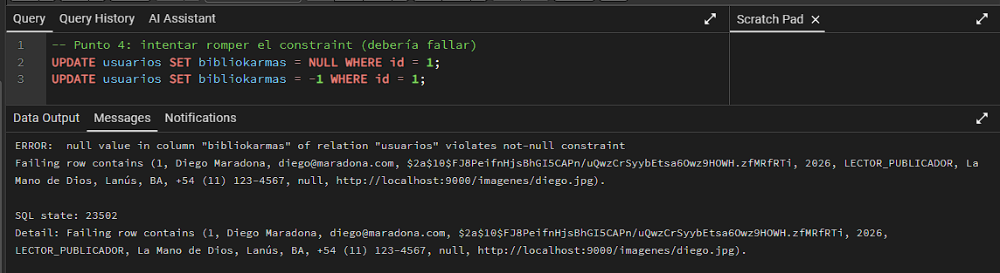
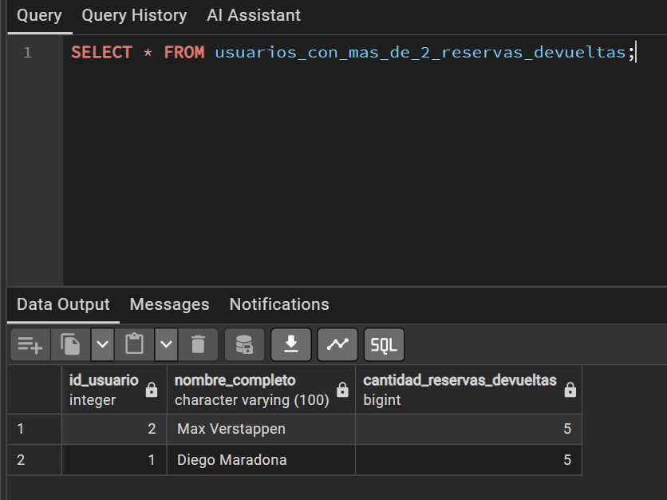
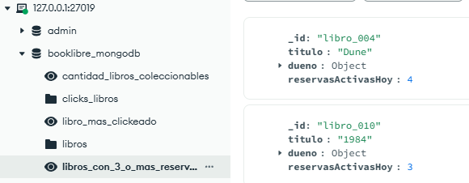

# Entregas del TP

BookLibre se construyó en cuatro entregas a lo largo de la cursada. Cada una tiene un tag con el estado del código en ese momento, separado en backend y frontend porque al principio eran dos repositorios.

| Entrega | Qué pedía | Tags |
|---|---|---|
| 0 | Casos de uso con interfaz y backend en Kotlin + Spring Boot, persistencia en memoria | [`entrega-0-backend`](https://github.com/solalcaraz/booklibre/tree/entrega-0-backend) · [`entrega-0-frontend`](https://github.com/solalcaraz/booklibre/tree/entrega-0-frontend) |
| 1 | Persistencia en PostgreSQL, autenticación con JWT y componentes en la base | [`entrega-1-backend`](https://github.com/solalcaraz/booklibre/tree/entrega-1-backend) · [`entrega-1-frontend`](https://github.com/solalcaraz/booklibre/tree/entrega-1-frontend) |
| 2 | Libros en MongoDB con un cluster de dos shards, log de clicks y consultas | [`entrega-2-backend`](https://github.com/solalcaraz/booklibre/tree/entrega-2-backend) · [`entrega-2-frontend`](https://github.com/solalcaraz/booklibre/tree/entrega-2-frontend) |
| 3 | Caché con Redis, API GraphQL para un tablero de KPIs y deploy en Render | [`entrega-3-backend`](https://github.com/solalcaraz/booklibre/tree/entrega-3-backend) · [`entrega-3-frontend`](https://github.com/solalcaraz/booklibre/tree/entrega-3-frontend) |

El tag [`tp-original-2026`](https://github.com/solalcaraz/booklibre/tree/tp-original-2026) junta los dos proyectos tal como los entregamos.

## Entrega 1: componentes en la base de datos

La consigna pedía resolver cinco requerimientos dentro de PostgreSQL, eligiendo entre vistas, triggers, funciones y constraints. Los scripts están en [`backend/src/main/resources/db/migration`](../backend/src/main/resources/db/migration) y Flyway los aplica al levantar la app.

**1. Libros que reservó un usuario en el año corriente.** Vista `libros_reservados_usuario_anio_corriente` (V4), que se filtra por usuario.

**2. Historial de cambios de puntaje de un libro.** Trigger sobre `resenias` (V2) que, en cada reseña nueva, compara el promedio anterior con el nuevo y, si cambió, guarda fecha, valor anterior y valor nuevo en `auditoria_puntaje_libro`. La función `fn_historial_puntaje_libro` devuelve ese historial.

**3. Usuarios con más de N reservas.** Función `usuarios_con_mas_de_n_reservas(n)` (V5), porque el umbral es un parámetro.

**4. Bibliokarmas nunca nulos fuera de la interfaz.** Constraints sobre `usuarios.bibliokarmas` (V6): `NOT NULL` con default 0, más un `CHECK` que impide valores negativos. La base rechaza el cambio aunque venga de un `UPDATE` manual.

**5. Usuarios con más de 2 reservas devueltas.** Vista `usuarios_con_mas_de_2_reservas_devueltas` (V7).

> En la Entrega 2 los libros pasaron de PostgreSQL a MongoDB y las migraciones V2, V4, V5, V6 y V7 quedaron comentadas, porque dependían de la tabla `libros`. En la versión final siguen comentadas; el `NOT NULL` de bibliokarmas se mantiene porque también está en V1. El código activo de esta entrega está en el tag `entrega-1-backend`.

## Entrega 2: MongoDB, clicks y consultas

Los libros se guardan como documentos en un cluster de dos shards, cada uno con un replica set de tres instancias, que levanta [`backend/compose.yaml`](../backend/compose.yaml) e inicializa [`backend/Docker/mongo/init-sharded-cluster.sh`](../backend/Docker/mongo/init-sharded-cluster.sh). La colección `libros` está particionada con una shard key hasheada sobre `dueno._id`.

Cada vez que alguien abre el detalle de un libro se guarda un documento en `clicks_libros` con fecha y hora, usuario y libro. Como bonus, el perfil del publicador muestra los clicks de cada uno de sus libros.

Las cinco consultas son vistas de Mongo que crea el mismo script de inicialización:

| Consulta | Vista |
|---|---|
| Libro más clickeado | `libro_mas_clickeado` |
| Cantidad de libros coleccionables | `cantidad_libros_coleccionables` |
| Libros con más de 4 puntos de calificación | `libros_con_mas_de_4_puntos` |
| Libros con al menos 3 reservas activas | `libros_con_3_o_mas_reservas_activas` |
| Libros con todas las reservas cumplidas | `libros_con_reservas_cumplidas` |

## Entrega 3: Redis, GraphQL y deploy

**Caché de populares.** Cada click suma un punto al libro en un sorted set de Redis (`libros:ranking`). El home toma los 10 primeros del ranking y busca sus datos en un hash con TTL de 30 segundos; si consigue al menos 6, los muestra sin tocar MongoDB. Si no, vuelve a cachear desde Mongo y el home cae a la búsqueda normal.

**Tablero de KPIs con GraphQL.** Una API GraphQL con Netflix DGS convive con la REST. Tiene una consulta por integrante:

| KPI | Consulta | De dónde sale |
|---|---|---|
| Conversión de clicks a reservas | `tasaConversionClicksReservas` | Top 5 de clicks en Redis cruzado con las reservas de PostgreSQL |
| Leaderboard de bibliokarmas | `leaderboardUsuarios` | Redis, con fallback a PostgreSQL y TTL de 5 minutos |
| Salud del catálogo | `estadoSaludCatalogo` | Buckets disjuntos que suman el total de libros |
| Calificaciones por tipo | `analisisCalificaciones` | Promedio de promedios en MongoDB, sin contar libros sin reseñas |
| Actividad reciente | `feedActividadReciente` | Libros nuevos y reservas en una lista ordenada, modelada como interface de GraphQL |

El esquema está en [`backend/src/main/resources/schema/schema.graphqls`](../backend/src/main/resources/schema/schema.graphqls) y la pantalla que lo consume, en `frontend/src/pages/Dashboard.tsx`.

**Deploy.** El back se desplegó en Render con el [`Dockerfile`](../backend/Dockerfile), junto con PostgreSQL y Redis de Render. MongoDB fue a Atlas, cuyo plan gratuito no permite sharding, así que en la nube quedó una instancia única y el cluster de dos shards se mantiene para correr en local.
